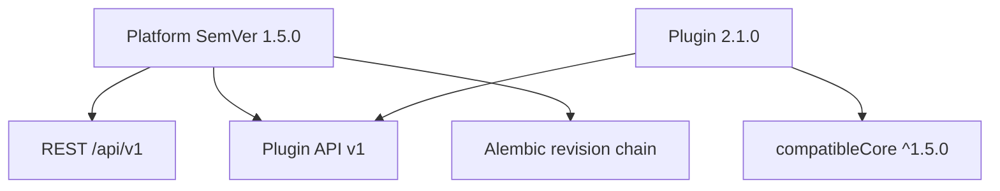

# API & Platform Versioning

| Field | Value |
|-------|-------|
| **Document ID** | FUT-VER-001 |
| **Product** | Founder Portfolio Platform (FounderOS) |
| **Version** | Planned (v1.5) |
| **Status** | Draft |
| **Last Updated** | 2026-06-29 |
| **Owner** | Platform Engineering |
| **Related** | [Plugin System](./Plugin_System.md) · [API Architecture](../04_Architecture/API_Architecture.md) · [Roadmap](./Roadmap.md) · [CHANGELOG](../../CHANGELOG.md) |

---

## Purpose

Define versioning strategy for FounderOS — REST API versions, plugin API compatibility, database migrations, and frontend release semantics — enabling safe upgrades for self-hosted, SaaS, and marketplace ecosystems.

---

## Scope

| In Scope | Out of Scope |
|----------|--------------|
| Semantic versioning policy | Legal trademark version numbers |
| API deprecation lifecycle | Mobile app store versioning |
| Plugin compatibility matrix | |

---

## Business Context

Plugins and agencies pin to stable APIs. Breaking changes without notice destroy marketplace trust. Clear versioning lets enterprise customers plan upgrade windows.

---

## Goals

1. Public API `/api/v1/` stable for 12 months minimum after v2 launch.
2. Plugin manifest declares `compatibleCore: ^1.5.0`.
3. CHANGELOG and migration guides for every minor/major.
4. Automated compatibility tests in CI for plugin API surface.

---

## Functional Requirements

| ID | Requirement | Priority |
|----|-------------|----------|
| FR-VER-001 | REST API versioned URL prefix `/api/v{n}/` | P0 |
| FR-VER-002 | Breaking changes ONLY in new major API version | P0 |
| FR-VER-003 | Deprecation header `Sunset` + 90-day notice minimum | P0 |
| FR-VER-004 | Platform releases follow SemVer `MAJOR.MINOR.PATCH` | P0 |
| FR-VER-005 | Plugin API version independent `pluginApiVersion: 1` | P0 |
| FR-VER-006 | DB migrations backward compatible within minor | P0 |
| FR-VER-007 | Admin displays current platform version | P1 |

---

## Non-functional Requirements

| ID | Requirement | Target |
|----|-------------|--------|
| NFR-VER-001 | Deprecation notice period | ≥ 90 days |
| NFR-VER-002 | v1 support after v2 GA | ≥ 12 months |

---

## User Stories

| ID | As a… | I want… | So that… |
|----|-------|---------|----------|
| US-VER-001 | Plugin author | stable hook API | my plugin doesn't break |
| US-VER-002 | Self-hoster | migration guide | I upgrade safely |
| US-VER-003 | Enterprise | predictable deprecation | I schedule maintenance |
| US-VER-004 | Developer | version in health endpoint | I debug deployments |

---

## UX Requirements

- Admin footer: `FounderOS v1.5.2` + link to changelog.
- Breaking change banner in admin 30 days before removal.
- Marketplace blocks install if plugin incompatible with core version.

---

## Technical Considerations

### Version Layers

| Layer | Scheme | Example |
|-------|--------|---------|
| Platform | SemVer | `1.5.0` |
| REST API | URL path | `/api/v1/`, `/api/v2/` |
| Plugin API | Integer | `pluginApiVersion: 1` |
| DB | Alembic revision | `a1b2c3d4e5f6` |

### Deprecation Policy

1. Announce in CHANGELOG + admin banner.
2. Add `Deprecation` response header on old endpoints.
3. Maintain parallel endpoints through notice period.
4. Remove in next major only.

- Git tags `v1.5.0` trigger [CI/CD](../13_Deployment/CI_CD.md) deploy.
- Health endpoint returns `{ "version": "1.5.0", "api": "v1" }`.

---

## Security Considerations

- Old API versions still receive security patches on supported branches.
- Plugin API changes security-reviewed before minor bump.
- No version downgrade attacks on migrations.

---

## Acceptance Criteria

- [ ] SemVer policy for platform documented
- [ ] REST URL versioning stated
- [ ] Deprecation lifecycle with 90-day minimum
- [ ] Plugin compatibility manifest field defined
- [ ] Cross-links to Plugin System and API Architecture

---

## Future Enhancements

- Automatic plugin compatibility CI for marketplace
- LTS releases (18-month support)
- GraphQL API v1 with separate versioning

---

## Open Questions

| # | Question | Owner |
|---|----------|-------|
| OQ-1 | Date-based calver for marketing vs SemVer internal? | Product |
| OQ-2 | Support N-2 API versions or N-1 only? | Engineering |
| OQ-3 | Version API in public docs site? | Developer Relations |
