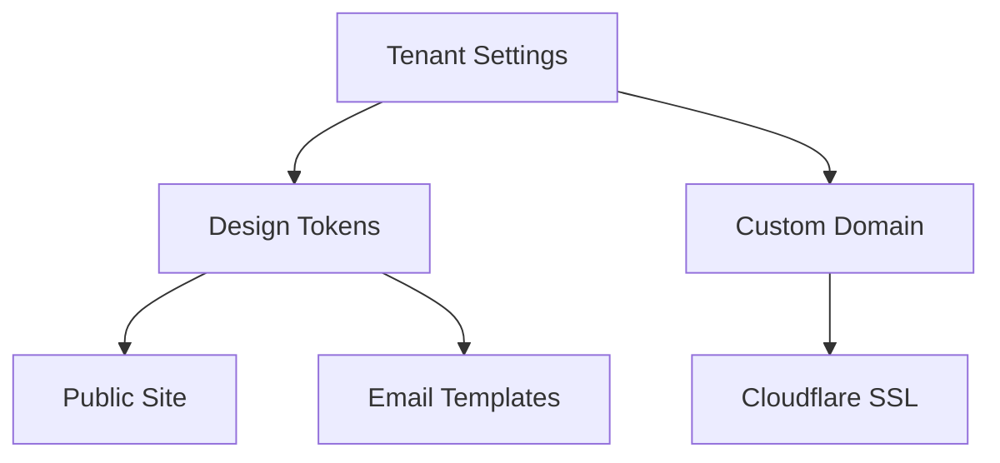

# White Label

| Field | Value |
|-------|-------|
| **Document ID** | FUT-WL-001 |
| **Product** | Founder Portfolio Platform (FounderOS) |
| **Version** | Planned (v1.5–v2.0) |
| **Status** | Draft |
| **Last Updated** | 2026-06-29 |
| **Owner** | Product / Brand |
| **Related** | [Brand Guidelines](../01_Brand/Brand_Guidelines.md) · [Multi Tenant](./Multi_Tenant.md) · [Settings (Admin)](../07_Admin/Settings.md) · [Enterprise Features](./Enterprise_Features.md) |

---

## Purpose

Define full white-label capabilities for FounderOS — removing platform branding, custom domains, email templates, and agency reseller workflows beyond v1.0 token overrides.

---

## Scope

| In Scope | Out of Scope |
|----------|--------------|
| Brand removal tiers | Reseller billing portal (initially manual) |
| Custom domain and SSL per tenant | Full OEM legal rebranding of codebase |
| White-label admin optional | |

---

## Business Context

Agencies resell founder sites at margin. "Powered by FounderOS" on Starter tier drives awareness; Pro+ removes it. Enterprise expects complete brand ownership and custom domains.

---

## Goals

1. Agency rebrands client site in &lt; 1 day.
2. Zero FounderOS visual presence on Enterprise tier.
3. Custom domain + auto SSL in &lt; 30 minutes.
4. White-label transactional emails.

---

## Functional Requirements

| ID | Requirement | Priority |
|----|-------------|----------|
| FR-WL-001 | Tier matrix: co-brand, partial, full white-label | P0 |
| FR-WL-002 | Remove "Powered by" badge per license | P0 |
| FR-WL-003 | Custom domain CNAME + auto cert (Cloudflare) | P0 |
| FR-WL-004 | Email templates: logo, colors, from-name | P1 |
| FR-WL-005 | Custom login page branding | P1 |
| FR-WL-006 | White-label PDF exports (case studies) | P2 |

---

## Non-functional Requirements

| ID | Requirement | Target |
|----|-------------|--------|
| NFR-WL-001 | Domain SSL provision | &lt; 15 min |
| NFR-WL-002 | Brand token override coverage | 100% public UI tokens |

---

## User Stories

| ID | As a… | I want… | So that… |
|----|-------|---------|----------|
| US-WL-001 | Agency | zero platform branding | client thinks it's ours |
| US-WL-002 | Tenant | custom domain | URL matches my brand |
| US-WL-003 | Enterprise | white-label emails | communications are on-brand |
| US-WL-004 | FounderOS | Starter co-brand | we gain referrals |

---

## UX Requirements

- Settings Brand tab covers v1.0 basics; v1.5 adds domain wizard.
- Domain setup: enter domain → DNS instructions → verify → SSL active.
- Preview mode: see site as visitor before DNS cutover.

### Tier Matrix

| Feature | Starter | Pro | Enterprise |
|---------|---------|-----|------------|
| Logo/colors | ✓ | ✓ | ✓ |
| Remove Powered by | ✗ | ✓ | ✓ |
| Custom domain | ✗ | ✓ | ✓ |
| White-label email | ✗ | ✗ | ✓ |
| Custom admin URL | ✗ | ✗ | ✓ |

---

## Technical Considerations

- Cloudflare for SaaS custom hostnames (SSL for SaaS).
- Tenant `settings.brand` extended in [Settings API](../08_API/Settings_API.md).
- Depends on [Multi Tenant](./Multi_Tenant.md) for isolation.
- See [Logo Guidelines](../01_Brand/Logo_Guidelines.md) for co-brand rules.

---

## Security Considerations

- Domain verification prevents hijacking.
- Tenant cannot claim domains they don't control (DNS TXT challenge).
- White-label login still enforces platform security patches.

---

## Acceptance Criteria

- [ ] Tier matrix documented
- [ ] Custom domain flow outlined
- [ ] Email white-label requirements listed
- [ ] v1.0 vs future capabilities distinguished
- [ ] Cross-links to Brand Guidelines and Multi Tenant

---

## Future Enhancements

- Reseller sub-accounts with margin billing
- Completely custom admin subdomain per tenant
- Brand kit export ZIP

---

## Open Questions

| # | Question | Owner |
|---|----------|-------|
| OQ-1 | Cloudflare for SaaS cost passed to tenant? | Finance |
| OQ-2 | White-label mobile app splash? | Product |
| OQ-3 | Mandatory co-brand on free OSS self-host? | Legal |
